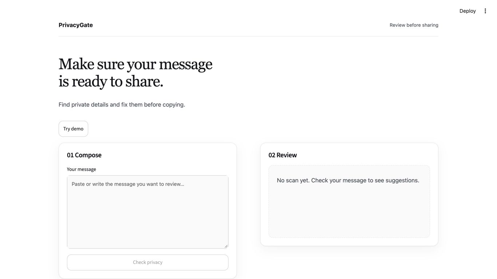
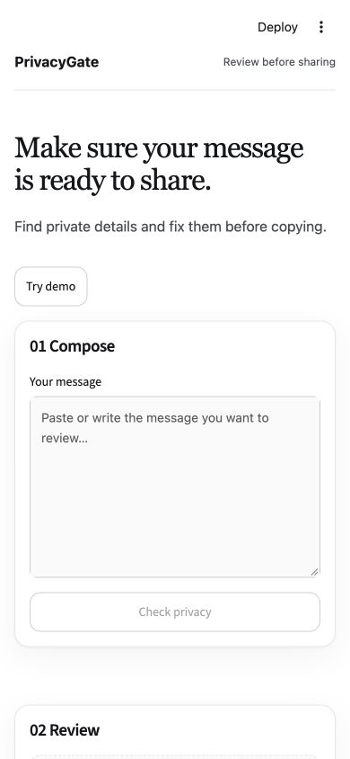

# PrivacyGate

A focused privacy assistant: **Compose → Review → Fix → Copy**. Inspect a draft for selected sensitive patterns, apply exact-span replacements, and copy the reviewed result. No external message is sent.

## Run locally

```bash
cd "/Users/yangjs/Documents/College Application/privacygate"
.venv/bin/python -m streamlit run app.py
```

Open http://127.0.0.1:8501. For a new checkout, create a Python 3.10+ virtual environment and install `requirements.txt`. Run from this directory to use the loopback binding and disabled usage telemetry in `.streamlit/config.toml`.

## A short demo

1. Select **Try demo**, then **Check privacy**. The single fictional sample contains an email warning and a blocked phone number.
2. Apply the phone fix. The original stays unchanged; the reviewed draft now contains `[PHONE_1]`.
3. Apply the email fix too, or acknowledge retaining that email in the exact reviewed message.
4. Choose **Copy reviewed message**. The server revalidates the current text; then **Copy to clipboard** performs the browser clipboard operation. A success message appears only after that operation succeeds. If unavailable, an approved-text selection fallback appears.
5. Edit either draft: earlier approval is invalidated. **Clear** removes session-held content and rules.

The second clipboard click preserves the browser user gesture after server validation. Clipboard access is browser-dependent. The application never claims an external message was sent.

## Implemented

- One Compose panel, one Review panel and a separate editable reviewed draft.
- One demo and one Clear control; no evaluation tabs, fake inbox or send controls.
- Specific reason, policy impact and actionable token replacement for each finding; batch fixes and optional exact-phrase marking.
- Stable repeated-value placeholders, overlap handling, current-text rescanning, blocking rules and exact-message warning acknowledgement.
- Editorial white/charcoal styling with forest-green accents based on the provided `site.zip` tokens. System sans-serif and Georgia fallbacks avoid network font requests. No portfolio content or assets copied.
- Keyboard focus rings, textual risk labels, status announcements and mobile stacking.

```text
Compose → detector → suggestions → reviewed draft
                                → canonical policy validation
                                → approved browser copy / manual-copy fallback
```

`app.py` loads `components/simple.py`; `suggestions.py` supplies pure exact-span fixes; `components/clipboard.py` handles browser clipboard success/failure. Established detectors, redaction and submission-service policy checks remain intact. Previous UI components are retained only for legacy regression tests, not imported by the product entry point.

## Privacy and limitations

Text is processed on the Streamlit server: local when run locally, remote when deployed remotely. No scanning API, analytics, database or user-message logging is added. Text, phrase rules and placeholder mappings live in session memory. Clear does not securely erase memory, browser history or clipboard contents.

Detection is incomplete and can produce false alerts. US phone formats, international email, contextual personal information and automatic name/address recognition have limitations. Version-context filtering can miss an IP mislabeled as a version. A checksum does not prove a real payment account. No match is not a privacy guarantee.

Manual copying bypasses this workflow. PrivacyGate cannot intercept third-party sites or system clipboard use. The optional browser extension is not implemented. The UI uses the AI Chatbot policy: phone/card/SSN/manual details block; email/IP warnings require current-text acknowledgement.

## Developer verification

```bash
.venv/bin/python -m pytest -q
.venv/bin/python evaluation.py
.venv/bin/python -m benchmarks.compare
```

Evaluation remains a developer CLI, not a public product page. See [evaluation methodology](docs/evaluation.md) and [verification](docs/VERIFICATION.md). Synthetic fixtures are not independent evidence of real-world effectiveness. Previous v3 UI tests run against an explicit historical harness under `tests/legacy/`; new focused-product tests exercise the actual `app.py`.




Implemented with OpenAI Codex at the student's request; Python, Streamlit, pytest and UI/UX Pro Max guidance. No contest submission or external deployment was made.
