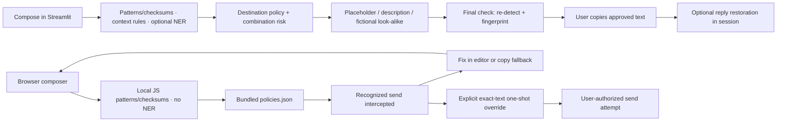

# PrivacyGate


**Catch the overshare before you hit send.** Compose → review → fix → copy.

## Live demo

[Try PrivacyGate](https://privacygate-ocsef.streamlit.app/).
The public demo processes text on a remote server (Streamlit Community Cloud). Use fictional text only.

## Run locally

```bash
git clone https://github.com/Microsoft666666/privacygate.git
cd privacygate
python -m venv .venv
source .venv/bin/activate  # Windows: .venv\Scripts\activate
pip install -r requirements.txt
python -m streamlit run app.py --server.address 127.0.0.1
```

## What it detects

The UI currently uses the AI Chatbot policy. Other destinations are available in the library.

| Category | Method | Fictional example | AI Chatbot | Public Forum | Personal Notes |
|---|---|---|---|---|---|
| EMAIL | pattern | alex@example.com | WARN | BLOCK | ALLOW |
| US_PHONE | pattern | 949-555-0134 | BLOCK | BLOCK | WARN |
| SSN | pattern | 123-45-6789 | BLOCK | BLOCK | BLOCK |
| PAYMENT_CARD | pattern + checksum | 4111 1111 1111 1111 | BLOCK | BLOCK | BLOCK |
| IPV4 | pattern | 192.168.1.10 | WARN | BLOCK | WARN |
| PARTIAL_DETAIL | pattern | [PARTIAL_EMAIL_1:a…] | WARN | BLOCK | WARN |
| MANUAL_IDENTIFIER | context rule | user-selected fictional phrase | BLOCK | BLOCK | BLOCK |
| MANUAL_ADDRESS | context rule | user-selected fictional phrase | BLOCK | BLOCK | BLOCK |
| MANUAL_CONFIDENTIAL | context rule | user-selected fictional phrase | BLOCK | BLOCK | BLOCK |
| USER_PHRASE | context rule | user-selected fictional phrase | BLOCK | BLOCK | BLOCK |
| INTL_PHONE | pattern + local validation | +44 20 7946 0958 | BLOCK | BLOCK | WARN |
| BANK_ACCOUNT | context + checksum | account 000123456789 | BLOCK | BLOCK | WARN |
| DATE_OF_BIRTH | context + calendar validation | born 03/07/2009 | WARN | BLOCK | ALLOW |
| SECRET | credential patterns | password assignment (fictional) | BLOCK | BLOCK | BLOCK |
| STREET_ADDRESS | US address pattern | 123 Main St, Irvine, CA 92618 | BLOCK | BLOCK | WARN |
| PERSON | Language model (may be wrong) | Jordan Lee | WARN | WARN | ALLOW |
| LOCATION | Language model (may be wrong) | Irvine | ALLOW | WARN | ALLOW |
| SCHOOL | Language model (may be wrong) | Northwood High School | WARN | WARN | ALLOW |
| NATIONAL_ID | CN format + MOD 11-2 checksum | 110105200001010016 | BLOCK | BLOCK | BLOCK |
| COMBINED_IDENTIFIERS | Three or more name/school/place/DOB categories | Name + school + city | WARN | BLOCK | ALLOW |

## How to use it

Select **College essay**, **Coding help**, **Public forum post**, or **Harmless text** to load a fictional scenario and its destination. **Quick contact** keeps the short introductory demo. Choosing a demo clears the previous session review. Follow the [three-minute draft demo script](docs/DEMO_SCRIPT.md).

Open **How it works** for the four detection layers, final-check guarantees, and limitations.

The highlighted preview labels each finding in text, escapes message HTML, and masks secret values.

Replacement styles: **Placeholder**, **Plain description**, and **Fictional look-alike**. IDs, bank data, and secrets always use placeholders. Generated values are exempted by exact value only after applying a fix, and that exemption is bound into final-check approval. Ambiguous or already-present replacements fall back to unique placeholders so restoration remains unambiguous. Changing style starts a fresh review.

After sharing revised text yourself, paste an AI reply into **Restore AI reply** to replace exact generated tokens with your originals. Restoration uses only this session’s mapping. Clear removes the reply, mapping, and restored output.

Choose AI chatbot, Public forum, or Personal notes before reviewing. Changing the destination resets acknowledgement and the final check.

Load **Try demo**, then **Check privacy**. Apply fixes individually or together.
Warnings require acknowledgement tied to the current message; blocks require fixes.
**Step 1 · Final check** performs a fresh server check; **Step 2 · Copy to clipboard** requests browser clipboard access. Clear removes session-held text and rules.

## Privacy model

Processing happens on the server running Streamlit. Local runs stay on your computer; hosted runs send text to the host. The application uses no external scanning API, database or message logging. Text and placeholder mappings remain in session memory. Clear does not securely erase memory, clipboard contents or browser history.

Detection is incomplete and can produce false positives. Names and places rely on an imperfect English model. Non-US addresses and contextual personal stories are not automatically covered. A checksum verifies format, not identity. No match is not a privacy guarantee. Manual copying bypasses the workflow. A browser extension beta is available in `extension/`; site adapters still require live testing. It checks local patterns only and does not run the name/place model.

## Developer verification

```bash
pip install -r requirements-dev.txt
python -m pytest -q
python evaluation.py
python -m benchmarks.compare
```

Synthetic evaluation cases are developer-authored, not independent evidence of real-world effectiveness.

## AI assistance

Author: [TODO: student name]. Built with assistance from OpenAI Codex for implementation, tests, documentation and presentation drafts. The student must review and explain the code and accurately describe their own contribution.

### Optional name and place model

Presidio with the installed English spaCy small model checks names, places, and school organizations. These model-based guesses can be wrong. No model is downloaded at runtime. Set `PRIVACYGATE_NER=0` to disable this layer; the app warns when names and places are not checked. Only the engine is cached, never messages or findings.

## Browser extension (beta)

In Chrome, open `chrome://extensions`, enable Developer mode, choose **Load unpacked**, and select this repository’s `extension/` folder. Open a supported chatbot page and check the PrivacyGate badge. Use the popup to enable or disable each site. No build step is needed.

The beta checks patterns locally before recognized Enter/send actions, offers fixes, and requires an explicit one-shot override for flagged text. It does not run NER; international phones use shapes rather than the Python validator. Site compatibility is unverified until the [manual QA checklist](extension/QA.md) is completed. Review the [limitations](extension/README.md).

Run `node --test extension/tests/` with Node 20 or newer.

The evaluation suite includes 60 hand-authored realistic messages across essay, homework, coding, and forum scenarios, including 20 negative controls. Name/place cases are tagged for NER analysis. These synthetic examples are not evidence of real-world accuracy.

## Measured evidence

See the [generated benchmark](docs/benchmark.md), [methodology](docs/evaluation.md), and [reproduction commands](docs/VERIFICATION.md). Reports include the frozen v2 detector, expanded patterns, NER, and a fixed 1,000-row English external sample, with false positives, misses, and latency. Synthetic results do not establish real-world accuracy.

Presentation draft: [pitch and evidence](docs/PITCH.md). Competition requirements and personal authorship statements remain for the student to confirm.

## Architecture



The browser shares the exported policy table and selected rule fixtures, not the Python runtime or language model. The hosted Streamlit branch processes input on its server; the browser branch scans inside the page. See [architecture notes](docs/ARCHITECTURE.md).

Prepare for code questions with the [judge Q&A and code walkthrough](docs/QA_PREP.md).
