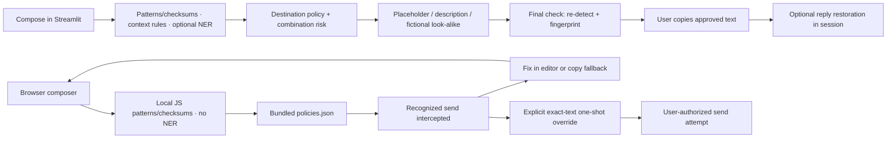

# Architecture and trust boundaries

The Streamlit server owns the authoritative final check. The browser clipboard component receives only an accepted snapshot and checks for pending editor changes before copying it. Fingerprints include text, destination, source context, policy version/table, manual rules, effective NER mode, and exact generated-value exemptions.

The local engine cache holds the model, not message results. Message text, proposed mappings, generated replacements, acknowledgements, and reply restoration stay in Streamlit session state. Clear removes them. Hosted sessions are processed remotely; session memory is not a promise of forensic erasure.

The extension is a separate implementation. Python exports bundled policy and pattern data; selected shared fixtures compare Python and JavaScript spans. The extension has no Python runtime or NER and uses shape-only international-phone rules. Content script state is tab-local. Only site-enable preferences are persisted. It intercepts recognized UI events and cannot control other site code or alternative send paths.

The final check does not call an AI provider. Users choose where to paste the reviewed text. Reply restoration uses a reply they paste themselves. The extension's explicit send override permits one unchanged-message replay, not blanket permission for future text.
