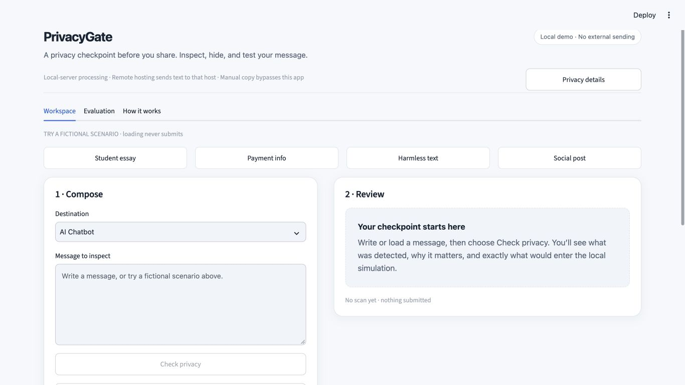
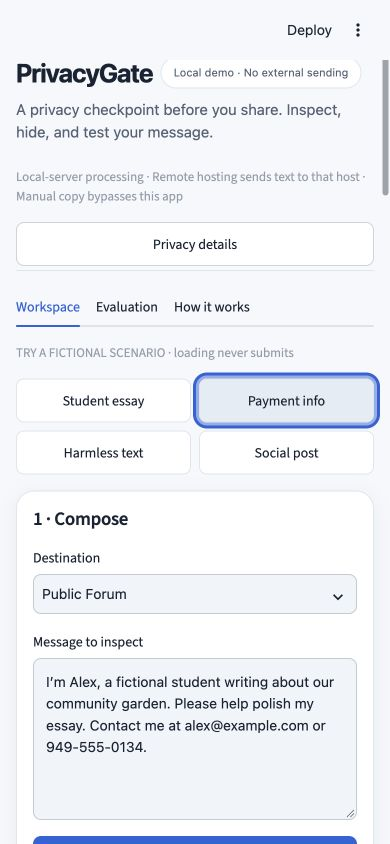
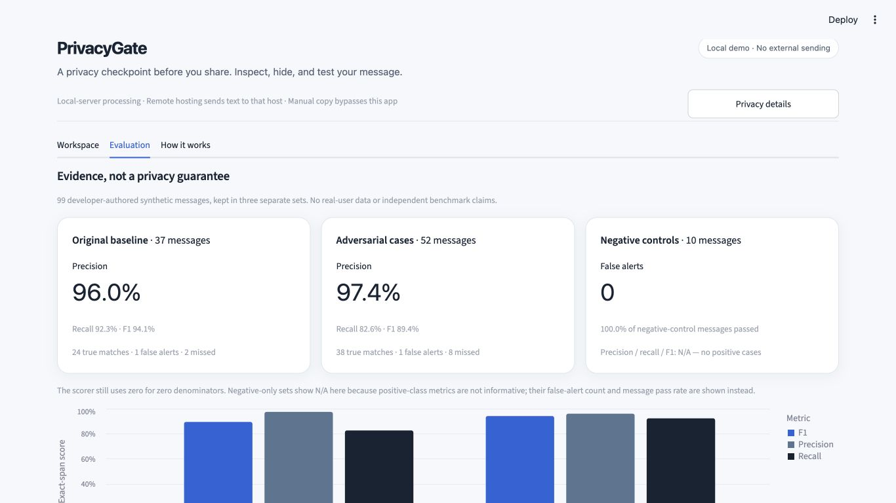

# PrivacyGate 3.0

**A privacy checkpoint before information leaves your control.** PrivacyGate answers OCSEFHacks Advanced 2 with a layered local guardrail: compose, inspect, selectively redact, and enforce destination policy before a controlled simulated disclosure.

## Run

Python 3.10+; no API key, account, hardware, paid service, or model download.

```bash
cd "privacygate"
python3 -m venv .venv
source .venv/bin/activate
pip install -r requirements.txt
python -m streamlit run app.py
```

On Windows use `.venv\Scripts\activate`; use your checkout path instead of this computer's absolute path. The environment is already installed on the build computer:

```bash
cd "privacygate"
.venv/bin/python -m streamlit run app.py
```

Open **http://127.0.0.1:8501**. Stop with Ctrl+C. Run from the project directory so `.streamlit/config.toml` binds the server to `127.0.0.1` and disables usage telemetry. Restart Streamlit after upgrading modules if its live process still holds older imports.

## Implemented

- Three-stage compose/review/simulation workspace and separate **Evaluation** and **How it works** tabs.
- Email, US phone, SSN-like, Luhn-valid payment-card and validated IPv4 pattern detection.
- Exact case-sensitive sensitive phrases, plus manual **Name**, **Address**, **Student identifier**, and **Other private detail** labels. No automatic name inference.
- Human-readable risk explanations, heuristic confidence labels, masked previews, deliberate reveal and precise offsets.
- Replace, Mask, and Remove modes with per-occurrence selection and stable placeholders for repeated exact values.
- A single fail-closed submission service, bound warning acknowledgement, gated approved copy, and visible rejected attempts.
- A local inbox holding only the most recent successfully approved message, with destination and classification. Prior receipts are explicitly separate from approval of the current draft.
- Four compact one-click fictional presets, reproducible reset, and full session clear.
- Responsive compose/review columns, one primary Check privacy action, keyboard focus rings, and safely escaped highlighted previews. Changing selections updates the outgoing preview and invalidates prior approval.
- Percentage charts, accessible score tables, loadable fictional failure cases, and an executable comparison with the frozen v2 detector.
- Separate baseline, adversarial and negative-control datasets; overall/per-category precision, recall, F1 and visible error analysis.

The app is rule-based, not machine learning. It never connects to ChatGPT, forums, or other real destinations.

## 90-second judge walkthrough

1. **Problem:** People accidentally paste identifiers into AI tools or public posts.
2. Load **Student essay** and press **Check privacy**. AI Chatbot warns on email and blocks phone.
3. Click **Test rejected attempt**. Show “Not sent — policy blocked” and the empty local inbox. The ordinary submit and approved-copy controls remain disabled.
4. Uncheck email and keep phone selected: the reviewed output updates immediately. **Redact selected** can also apply the current choices. The remaining email requires acknowledgement. A rejected attempt still leaves the inbox empty.
5. Acknowledge, then **Submit to simulated destination**. Only the final reviewed output appears in the local inbox; no external transmission occurs.
6. Switch to **Public Forum**, or edit reviewed text to add `949-555-0134`: acknowledgement/prepared copy clears and sending blocks again. Any old inbox receipt remains clearly labeled historical until Reset simulation.
7. Show measured errors under **Evaluation**, then explain that manual copying and external websites are outside this guardrail.

For the manual-marking differentiator, load **Social post**, scan, enter `Alex Chen` under **Add a missed sensitive detail**, choose **Name**, and click **Protect this phrase**. Both occurrences become user-provided findings. Redact all or uncheck particular occurrence cards. Only deliberately configured phrases are detected as names.

Other presets: **Payment info** is a test-only support note using a conventional fictional Luhn-valid card fixture; **Harmless text** is a benign school/garden request with ordinary numbers. Each preset sets the intended destination and provides its own expected outcome and judge script. Presets never submit anything.

### Verified browser screenshots

Only fictional seeded messages appear in these captures.





Previous UI captures and measured results are retained in `docs/baseline-v2/` for comparison.

## Architecture and authoritative enforcement

```text
Streamlit browser widgets → local Python server
    → detector.py: patterns + exact user phrase rules
    → risk cards → redaction.py → editable final output
    → submission_service.evaluate_submission(final_text, destination, acknowledgement, context, rules)
        → fresh scan → policy validation → warning fingerprint check
        → metadata-only decision
    → approved-copy text OR session-only simulated inbox
```

`submission_service.py` is the final authority for UI state, simulated sends, and prepared copies. It rescans on every action and returns action, acceptance, categories, reasons, counts and a review fingerprint—never the original values in an audit record. Invalid destinations, incomplete/invalid policies, and scanner exceptions produce a generic blocking error without echoing exception contents. `policy.submit_simulated()` remains a compatibility wrapper around this service.

Acknowledgements bind to exact final text, destination, policy version, full current policy data, source/selection/redaction-mode context, and sensitive phrase rules. Editing any of these invalidates approval. BLOCK cannot be overridden. Fingerprints are state bindings, not authentication tokens; hostile code with access to this process is outside the prototype's threat model.

### Policies

| Category | AI Chatbot | Public Forum | Personal Notes (local demo) |
|---|---|---|---|
| Email | WARN | BLOCK | ALLOW |
| US phone | BLOCK | BLOCK | WARN |
| SSN-like / payment card | BLOCK | BLOCK | BLOCK |
| IPv4 | WARN | BLOCK | WARN |
| Partial-mask marker | WARN | BLOCK | WARN |
| User phrases / manual labels | BLOCK | BLOCK | BLOCK |

Unknown finding categories block. Missing required category rules or unsupported actions reject validation. ALLOW means no rule prevents this simulation, not “safe” or “private.”

### Redaction and manual marking

Manual rules use exact, case-sensitive literal matching, not regex. All matched occurrences initially have redaction selected; individual checkboxes allow choosing occurrences. The rule stays active for final-output scanning even when an occurrence is not selected for redaction. Removing a rule is an explicit change to what the user considers sensitive.

Overlaps resolve deterministically: user-marked phrases, partial-mask markers, payment cards, SSN-like patterns, email, then phone/IP; longer spans win ties, then earliest position. Redaction validates spans against the current text and replaces them back-to-front. Placeholder IDs are assigned over all findings before selection, so toggling a checkbox does not renumber identical values.

- **Replace:** descriptive placeholders such as `[EMAIL_1]` and `[MANUAL_IDENTIFIER_1]`.
- **Mask:** e.g. `[PARTIAL_EMAIL_1: a•••m]`; retains limited original characters and a detectable marker. AI/notes require acknowledgement; public policy blocks. This is not anonymization. Deleting the marker can defeat this added warning.
- **Remove:** deletes only selected spans, preserving neighboring whitespace/punctuation rather than silently rewriting unrelated text. Review leftover spacing yourself. Empty outputs are supported.

## Privacy boundaries

The browser sends editor text to the Streamlit server. When both run locally, processing stays on this computer. On a remote deployment, text travels to that host. Dependency installation downloads packages; runtime scanning uses no network API, external model, database, or analytics. No external fonts or scripts were added by the application.

No source, reviewed text, inbox content, or sensitive phrase rules are written to files, application logs, analytics, or message audit trails. These values exist temporarily in browser/server session memory. The only committed/downloadable evidence is developer-authored synthetic data and screenshots. The inbox contains one approved message, not an attempt history. Failed-attempt results contain only sanitized metadata.

**Manual copying bypasses this application.** Editors, reveal controls, browser selection and the OS clipboard can still copy blocked text. “Prepare approved copy” gates only that dedicated action. PrivacyGate does not intercept other sites, browser-wide submissions, or external paste operations.

**Clear session** clears input, output, rules, findings/choices, acknowledgements, prepared-copy state, results and local inbox. **Reset simulation** clears the inbox and approval/result state while preserving the draft. **Reset demo** restores the selected preset, destination and default rules/mode. None securely erases browser/OS history, clipboard copies, or process memory.

## Verification and methodology

```bash
pytest -q
python evaluation.py
python -m benchmarks.compare
python -m compileall -q app.py components benchmarks detector.py policy.py submission_service.py redaction.py evaluation.py tests
```

The initial build had **50 passing tests**, v2 had **87**, and v3 has **125 passing tests** (including 11 AppTest flows). Current verification and generated metrics are recorded in [Verification](VERIFICATION.md). Tests cover pure detection/redaction/policy logic, direct service bypass attempts, invalid configuration and scanner failure, stale acknowledgements, and Streamlit widget/session transitions.

The original **37 messages and gold annotations are preserved unchanged**. The separate **52-message adversarial set** was hand-written using explicit annotated fragments, covering punctuation, spacing, Unicode, repeats, numeric ambiguity, invalid checksums, IPv4 boundaries, manual rules and partial masks. Gold labels never come from calling the detector. The **10-message negative-control set** separately checks benign/unsupported-format examples. An IPv6 string in negative controls is out of scope, not a claim that IPv6 cannot be sensitive.

Exact `(category, start, end)` matches are scored as multisets; duplicate predictions count as false positives rather than inflating matches. Precision, recall and F1 use 0 when denominators are zero. The UI displays N/A for positive-class metrics on negative-only sets, with false alerts and message pass rate instead; raw scorer values remain unchanged. The error table includes only fictional dataset text. Runtime measurements scan 1,000 synthetic characters 100 times and report the median; they exclude browser/network/UI overhead and are machine-specific.

These are small, developer-authored synthetic examples, not real user data, an independent benchmark, or proof of generalization. The v3 version-context filter removes one false positive from each positive dataset with no true-positive loss on these annotations. A real IP mislabeled as a version can be missed; explicit nearby IP/network context takes precedence.

| Dataset | Messages | TP / FP / FN | Precision | Recall | F1 |
|---|---:|---|---:|---:|---:|
| Original | 37 | 24 / 1 / 2 | 96.0% | 92.3% | 94.1% |
| Adversarial | 52 | 38 / 1 / 8 | 97.4% | 82.6% | 89.4% |
| Negative controls | 10 | 0 / 0 / 0 | N/A | N/A | N/A |

Negative controls: 0 false alerts, 100% message pass rate. Run `python -m benchmarks.compare` to reproduce the before/after comparison against unchanged gold annotations.

## Known limits and future work

Patterns can miss data and mistake unrelated IDs/version numbers for PII. Email coverage is not full RFC/internationalized coverage. Phone support is US-focused; nonbreaking/tab spacing, international phones and extensions are incomplete. SSN formats and Luhn checks do not validate identities/accounts. Adjacent numeric fields can merge and be missed. Custom phrases are exact and case-sensitive. Automatic address/name detection, contextual secret discovery and semantic interpretation are not implemented.

No independent security audit has been performed. This prototype is not a replacement for established DLP/privacy systems. Future work could include independent datasets, improved phone parsing, carefully scoped address/token heuristics, configurable policies, and a browser extension on a controlled local form. **The optional P3 extension is not implemented and should not be presented as working.**

## Acknowledgments

Implemented and upgraded with OpenAI Codex at the student's request and with their stated authorization for AI-assisted coding. Uses Python standard-library logic, Streamlit and its AppTest framework, pytest, and UI/UX Pro Max guidance. Synthetic card values are conventional test fixtures, never real payment credentials. The student should understand the implementation, disclose assistance under organizer requirements, and present measured claims in their own words. No Devpost submission was made.
