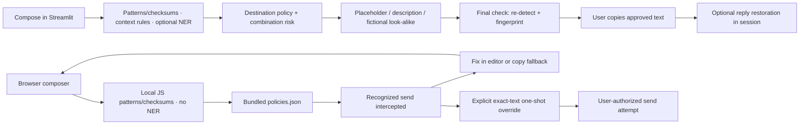

# PrivacyGate pitch

[TODO: confirm with official rubric] — this is a draft narrative, not a statement of competition rules.

## 1. One line

**Catch the overshare before you hit send.**

## 2. Problem

An essay draft, homework question, or debugging snippet can include details the writer did not intend to share: contact information, a name plus school plus city, or an access key. PrivacyGate gives the writer a chance to see and revise supported details before copying or using a supported browser send control.

This pitch makes no prevalence or adoption claim. Any future numerical problem statement needs `[CITATION NEEDED]` before presentation.

## 3. Who it is for

High-school and college students reviewing messages, with teachers and parents as potential supporters. These are intended users, not validated customers. [TODO: student — explain the personal observation that inspired the project; do not invent interviews.]

## 4. Demo

Use fictional text only. Follow the [demo script](DEMO_SCRIPT.md): essay → combined details → replacements → final check → optional reply restoration. A coding snippet demonstrates why a key is more than an ordinary word. The extension moment is conditional on passing its live-site QA.

## 5. How it works

The four layers are format/checksum rules, nearby context, an installed English name/place model, and combination risk. The model is Presidio plus spaCy; the project does not claim to have trained it. The product contribution is the review workflow, destination policy, reversible fixes, final-check enforcement, and experimental browser adapter.

## 6. Why you can trust the checks—and their limits

| Property | Code to show | Evidence / limit |
| --- | --- | --- |
| Unknown categories and validation errors fail closed | [policy.py](../policy.py), [submission_service.py](../submission_service.py) | `test_invalid_policy_fails_closed`, `test_invalid_destination_fails_closed`, `test_scanner_error_fails_closed_without_echo` in [service tests](../tests/test_submission_service.py); policy keeps a BLOCK fallback |
| Re-check before copy | `prepare_copy()` and `check()` in [simple.py](../components/simple.py) | `test_server_copy_callback_cannot_bypass_block` in [UI tests](../tests/test_simple_app.py) |
| Acknowledgement is tied to the exact state | `review_fingerprint()` in [policy.py](../policy.py) | `test_edited_text_and_context_rejected`, `test_changed_policy_and_version_invalidate_acknowledgement`; generated exemptions and NER mode are also fingerprinted |
| State stays within the session | [simple.py](../components/simple.py), [suggestions.py](../suggestions.py) | `test_restore_and_clear` in [restore tests](../tests/test_restore.py); Clear removes session state, not clipboard/history or a forensic memory image |
| No raw exception echo | [submission_service.py](../submission_service.py), [ner.py](../recognizers/ner.py) | Service/model failure tests; generic fallback messages |
| User text is escaped | [preview.py](../components/preview.py) and native Streamlit text widgets | `test_preview_escapes_every_segment`, `test_preview_masks_secret` in [preview tests](../tests/test_preview.py) |
| Model failure is visible | [ner.py](../recognizers/ner.py), [simple.py](../components/simple.py) | `test_analysis_failure_keeps_patterns_and_reports_failure`, `test_unavailable_warning` in [NER tests](../tests/test_ner.py) |
| Browser rules are reproducible | [extension detector](../extension/detector.js), [shared fixtures](../fixtures/detector_cases.json) | Node parity tests; live send interception still needs the [manual QA checklist](../extension/QA.md) |

Source review finds no application message logging or persistent message storage. These tests are evidence for specific behaviors, not a proof that every browser, host, dependency, or failure mode is safe. The public Streamlit demo processes text on a remote host.

## 7. Results

The tables below are copied verbatim from the generated report. Full per-category counts, environment, mapping caveats, and reproduction details are in [benchmark.md](benchmark.md). The hand-authored set is intentionally small; the external sample is broader and substantially harder. Do not present synthetic scores as real-world accuracy.

<!-- GENERATED_RESULTS_START -->

| Dataset | Mode | Messages | Precision | Recall | F1 | Flagged negatives | Negative FPR |
| --- | --- | --- | --- | --- | --- | --- | --- |
| Adversarial 52 | ner | 52 | 0.974 | 0.826 | 0.894 | 1/14 | 0.071 |
| Adversarial 52 | regex | 52 | 0.974 | 0.826 | 0.894 | 1/14 | 0.071 |
| Adversarial 52 | v2 | 52 | 0.950 | 0.826 | 0.884 | 2/14 | 0.143 |
| Original 37 | ner | 37 | 0.923 | 0.923 | 0.923 | 1/15 | 0.067 |
| Original 37 | regex | 37 | 0.960 | 0.923 | 0.941 | 1/15 | 0.067 |
| Original 37 | v2 | 37 | 0.923 | 0.923 | 0.923 | 2/15 | 0.133 |
| Realistic 60 | ner | 60 | 0.956 | 0.977 | 0.966 | 0/20 | 0.000 |
| Realistic 60 | regex | 60 | 0.971 | 0.773 | 0.861 | 0/20 | 0.000 |
| Realistic 60 | v2 | 60 | 0.933 | 0.318 | 0.475 | 1/20 | 0.050 |

| Mode | Characters | Runs | p50 ms | p95 ms |
| --- | --- | --- | --- | --- |
| ner | 500 | 50 | 10.121 | 10.256 |
| ner | 2000 | 50 | 38.030 | 39.555 |
| regex | 500 | 50 | 0.253 | 0.270 |
| regex | 2000 | 50 | 1.001 | 1.029 |

The target is p95 below 300 ms for 2,000 characters; this local measurement is not a CI or hosted-memory guarantee.

Synthetic English validation sample: 1000 rows; fixed seed 20261115; dataset fingerprint `7dcf72ef576ca7d9`.

| Mode | Scoring | TP | FP | FN | Precision | Recall | F1 |
| --- | --- | --- | --- | --- | --- | --- | --- |
| ner | exact | 1004 | 847 | 2469 | 0.542 | 0.289 | 0.377 |
| ner | overlap | 1176 | 675 | 2297 | 0.635 | 0.339 | 0.442 |
| regex | exact | 722 | 258 | 2751 | 0.737 | 0.208 | 0.324 |
| regex | overlap | 820 | 160 | 2653 | 0.837 | 0.236 | 0.368 |
| v2 | exact | 635 | 217 | 2838 | 0.745 | 0.183 | 0.294 |
| v2 | overlap | 703 | 149 | 2770 | 0.825 | 0.202 | 0.325 |

<!-- GENERATED_RESULTS_END -->

## 8. Compared with alternatives

This compares documented designs, not benchmarked competitors. Sources were checked on 2026-11-15.

| Approach | Who it is for | Works at send time | Runs locally | Explains why | Fixes in place |
| --- | --- | --- | --- | --- | --- |
| PrivacyGate | Student-facing review prototype | App checks before copy; extension attempts interception on recognized controls, live QA pending | Local app and extension; public app is remote | Category reasons and destination actions | App replacements; extension editor update with copy fallback |
| Presidio library and demo | Developers integrating detection/anonymization | Integration-dependent; demo is a separate analysis surface | Python/Docker execution supported | Recognizer decision tracing is documented | Anonymization operators; editor-specific behavior requires integration |
| PrivyGate (EuroShield-AI) | Organization/internal-tool integration | Its documented processing pipeline redacts before its LLM step; browser composer interception [VERIFY] | Self-hosting documented; its LLM processing uses an external provider | End-user reason UI [VERIFY] | Reversible pseudonymization documented; browser editor fixes [VERIFY] |
| Manual self-review | Anyone writing a message | When the writer chooses to review | Can be done locally | Writer supplies judgment | Writer edits the text |

Presidio began at Microsoft and its current docs identify a community-owned project. It offers a library, demo, recognizers, and anonymization—not merely a regex checker. PrivacyGate uses it for the language-model layer. [Presidio documentation](https://presidio.dataprivacystack.org/).

The reviewed PrivyGate project documents REST redaction/process/reveal endpoints and organization integrations. A drop-in “change the API base URL” claim is **not verified for this project**, so it is not used as a comparison fact. [PrivyGate README](https://github.com/EuroShield-AI/PrivyGate).

## 9. Limitations and ethics

Detection misses details and can overflag harmless text. The English model can misidentify names and schools. Non-US addresses, free-form personal stories, nicknames, images, and unsupported languages need more work. Valid checksums do not identify a real person. Replacements can remove useful context; the user must review the result.

The extension has no NER, relies on changing site selectors, and cannot prevent the host page from reading its own composer. Other send paths may bypass it. The app cannot stop copying outside its controlled flow. Remote hosting receives the input. No compliance certification, universal safety, user adoption, or model-training claim is made.

## 10. What is next

Validate the browser adapters on all three sites; test with consented fictional workflows; expand independently annotated multilingual and contextual cases; improve false-negative coverage without hiding false positives; measure hosted resource use and cold start. Response restoration in the extension is a possible later feature, not implemented here.

## 11. Team and AI assistance

[TODO: student name, teammates, roles.] OpenAI Codex assisted with implementation, tests, and document drafts. Presidio, spaCy, phonenumbers, Streamlit, and other dependencies supply existing capabilities. [TODO: student — rewrite this section in your own words and explain which design decisions you personally made, tested, and understand.]
